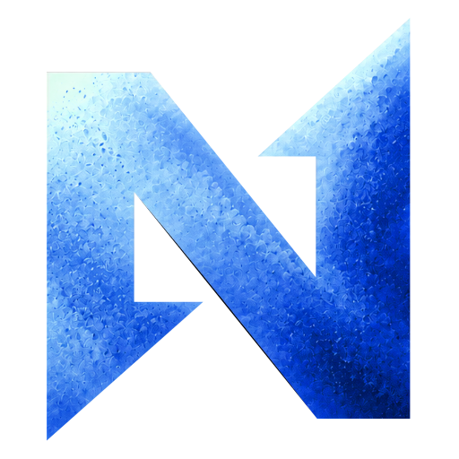
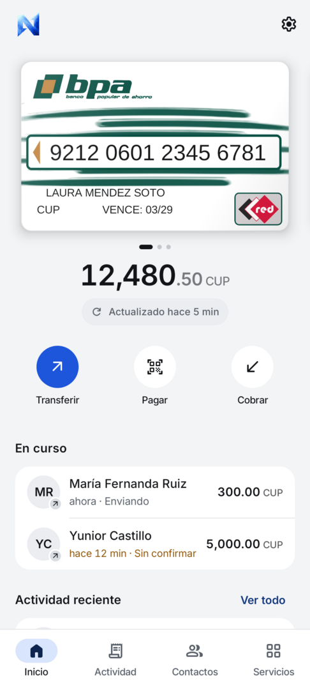
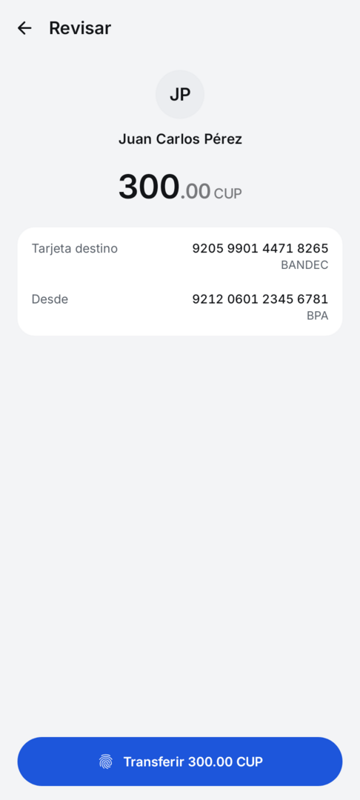
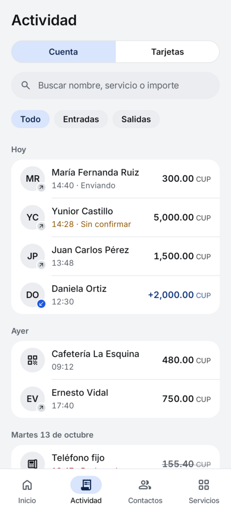

<p align="center">
  
</p>

<h1 align="center">NeoTransfer+</h1>

<p align="center">
  Tu cuenta ENZONA en el teléfono: tarjetas y saldo, transferencias, pagos con QR, cobros y servicios.
</p>

<p align="center">
  <a href="https://github.com/duardor968/NeoTransferPlus/releases/latest"><b>Descargar el APK</b></a>
</p>

<p align="center">
  
  
  
</p>

NeoTransfer+ es una app Android independiente para ENZONA. No está afiliada a XETID, a ENZONA ni a los bancos: usa la API personal de ENZONA con tu propia cuenta, igual que la app oficial.

## Qué hace

- **Cartera.** Las tarjetas que tienes vinculadas en ENZONA, con su saldo y cuándo se leyó. ENZONA solo da los cuatro últimos dígitos: puedes completar el número para verlo y copiarlo.
- **Transferir** a una tarjeta (escribe el número, escanéalo o elige un contacto) o a una cuenta ENZONA, leyendo su QR. Revisas el destino y el importe y confirmas con la huella.
- **Pagar con QR** de comercios ENZONA: la app consulta el código, te muestra el comercio y el importe (o lo escribes tú, si el QR no lo trae) y pagas con la huella.
- **Cobrar.** Escribe el importe y ENZONA genera el QR de tu cuenta, para mostrarlo o compartirlo.
- **Servicios:** facturas de electricidad y de teléfono fijo, y recargas de Nauta y Nauta Hogar, con la deuda pendiente a la vista. Lo que ya pagaste queda a un toque.
- **Actividad.** El historial de tu cuenta ENZONA, con búsqueda, entradas y salidas, y días anteriores bajo demanda; cada operación con su comprobante para compartir. Y los últimos movimientos que el banco informa de cada tarjeta.
- **Transferencias recibidas.** Con conexión, la app revisa tu cuenta cada 15 minutos aunque esté cerrada y te avisa de quién te transfirió y cuánto.
- **Contactos.** Varias tarjetas y teléfonos por persona, escritos, escaneados o importados de los contactos del teléfono.
- **Escáner.** Lee QR y números de tarjeta y de móvil, impresos o escritos a mano, también desde una imagen. Lo abres desde la app, con «Escanear» al mantener pulsado el icono o desde los Ajustes rápidos. El QR de tarjeta de Transfermóvil abre una transferencia a esa tarjeta.

## Cómo funciona

Entras con tu usuario de ENZONA en la página de acceso de ENZONA, dentro de la app. A partir de ahí la app habla por Internet con los servidores de ENZONA, como la app oficial, y guarda en el teléfono lo último que leyó para mostrarlo aunque no haya conexión.

Cada pago se envía una sola vez. Si la respuesta no llega, queda «Sin confirmar» y se comprueba en la actividad: la app nunca lo reenvía sola.

Es una versión temprana que sigue el contrato de la app oficial y lo comprueba con pruebas automáticas, pero todavía no se ha probado contra el servidor de ENZONA; si algo no sale como esperas, abre un [issue](https://github.com/duardor968/NeoTransferPlus/issues) sin datos personales.

## Requisitos

- Android 15 o más nuevo, de 64 bits.
- Una cuenta ENZONA con tus tarjetas ya vinculadas en la app oficial. NeoTransfer+ no crea cuentas ni vincula tarjetas.
- Conexión a Internet en la red cubana, con datos móviles o wifi.
- Una huella configurada en el teléfono para pagar.

## Instalación

NeoTransfer+ no está en Google Play: se instala desde GitHub.

1. En el teléfono, abre la [última versión](https://github.com/duardor968/NeoTransferPlus/releases/latest) y descarga el archivo `.apk`.
2. Ábrelo. Android te pedirá permiso para instalar apps desde el navegador o el administrador de archivos: concédelo y toca «Instalar».

Las versiones nuevas se instalan igual, encima de la anterior, y conservan tus datos. Cada versión publica la suma SHA-256 del APK para que puedas comprobarlo.

## Primeros pasos

1. Al abrir la app, Android te pide Cámara, Notificaciones y Contactos de una vez. Ninguno es obligatorio para entrar.
2. Toca «Entrar con ENZONA» y escribe tu usuario y contraseña en la página de ENZONA.
3. La app lee tu cuenta, tus tarjetas, sus saldos y la actividad de la última semana.
4. Si quieres ver el número completo de una tarjeta, tócala y escríbelo.
5. En el primer pago, escribe tu contraseña de pago de ENZONA y confírmala con la huella. Desde entonces, cada pago solo pide la huella.

Con el bloqueo de pantalla activado, la app se desbloquea con la huella o el PIN del teléfono al abrirla y al volver después de un minuto fuera.

## Privacidad

- Sin servidores propios, cuentas, analítica ni publicidad: la app solo habla con ENZONA (`api.enzona.net` e `identity.enzona.net`), siempre por HTTPS.
- Tu contraseña de acceso la escribes en la página de ENZONA; la app guarda solo la sesión, cifrada con una clave del Android Keystore.
- La contraseña de pago se guarda cifrada y solo se abre con tu huella; si registras una huella nueva, se borra y la app la pide otra vez. Viaja cifrada con la clave pública de ENZONA en cada pago.
- Al entrar, como hace la app oficial, la app envía a ENZONA datos básicos del teléfono: modelo, fabricante, placa, versión y compilación de Android, tipo de red y dirección IP local. Nunca el IMEI ni el número de la SIM.
- Tarjetas, saldos, actividad y contactos se guardan en el teléfono y no entran en las copias de seguridad de Google. Cerrar sesión borra la sesión, las tarjetas, los saldos, el historial descargado y la contraseña de pago; los contactos se conservan.
- El escáner lee los códigos en el propio teléfono, con ML Kit empaquetado en la app. La app retira el componente con el que ML Kit envía informes de uso a Google, así que no salen.
- En la pantalla de bloqueo, las notificaciones solo dicen «Transferencia recibida». Las pantallas con contraseñas no permiten capturas.

## NeoTransfer

[NeoTransfer](https://github.com/duardor968/NeoTransfer) es la app hermana para Transfermóvil: opera con BPA y BANDEC por USSD y SMS, y funciona sin datos móviles. Son apps independientes; puedes tener las dos.

## Desarrollo

Kotlin y Jetpack Compose, en cuatro módulos: `core` (contrato de ENZONA, Kotlin puro), `designsystem`, `scanner` y `app`. Necesitas JDK 21 (sirve el de Android Studio) y Android SDK 36.

```powershell
.\gradlew.bat :core:test :scanner:testDebugUnitTest :app:testDebugUnitTest :app:assembleDebug
```

- [Desarrollo y pruebas](docs/desarrollo.md): variantes, capturas, pruebas en el teléfono y firma.
- [Arquitectura](docs/arquitectura.md): módulos, sesión, transporte, pagos, caché y seguridad.
- [Contribuir](CONTRIBUTING.md) · [Seguridad](SECURITY.md)

## Licencia

[Apache 2.0](LICENSE). Las fuentes Inter y Arimo (OFL) y los iconos Material Symbols (Apache 2.0) conservan sus licencias, incluidas en `app/src/main/assets/licenses/`.

Los fondos de las tarjetas BPA y BANDEC son reconstrucciones vectoriales hechas a partir de fotos de tarjetas, no archivos oficiales de los bancos; los logotipos y marcas que muestran pertenecen a sus dueños. No contienen datos personales: el número, el titular y el vencimiento los dibuja la app.
